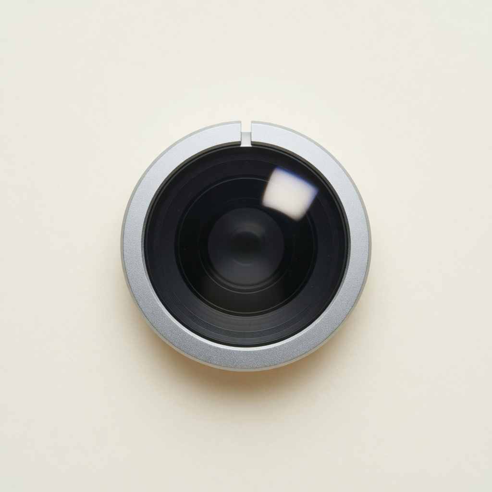

<div align="center">

<picture>
  <source media="(prefers-color-scheme: dark)" srcset="AppIcon.icon/Assets/presence-dark.png">
  <source media="(prefers-color-scheme: light)" srcset="AppIcon.icon/Assets/presence-light.png">
  
</picture>

# Presence

**You get up to pee. The meeting still sees you.**

Record a short take while the call still shows you live. Check it. Send that take, on a loop, and go. Come back, and the call sees you live again.

The take stays in memory. Nothing is saved to disk. Mute yourself before you leave.

**Zoom will not list a camera named Presence until Apple has signed the app.** You select the camera named at the bottom of the Presence window. That name is OBS Virtual Camera or Elgato Virtual Camera. Set the meeting background to None, or the background is painted twice.

Mac only. MIT license.

<p>
  <a href="LICENSE"></a>
  <a href="https://x.com/mrmakallen"></a>
</p>

Built and maintained by <b>Mak Allen</b> of the <a href="https://github.com/HeroForgeAI">HeroForge.AI</a> team. Find him on X: <a href="https://x.com/mrmakallen">@mrmakallen</a>.

</div>

## Set it up

You need a Mac on macOS 26 or later, with Xcode 26 or later. This is not an App Store app, and a download does not need to be notarized for you to build it yourself.

```bash
git clone https://github.com/HeroForgeAI/presence.git
cd presence
xcodegen generate
DEVELOPER_DIR=/Applications/Xcode.app/Contents/Developer \
  xcodebuild -scheme Presence -configuration Debug -destination 'platform=macOS' build
```

The built app is under `build/`. Copy it to `~/Applications` if you want it beside your other apps. Tests:

```bash
DEVELOPER_DIR=/Applications/Xcode.app/Contents/Developer \
  xcodebuild -scheme Presence -destination 'platform=macOS' test
```

Then:

1. Allow the camera prompt. If no prompt appears, turn Presence on under System Settings, Privacy & Security, Camera. Building an unsigned copy again can require that switch once more. The menu lists every real webcam: the camera built into a MacBook, a USB camera, a phone, or a Facecam. A virtual camera is not in that menu, so the picture cannot loop back on itself.
2. In Zoom, Meet, or Teams, choose the camera named at the bottom of the Presence window. It is not your built-in camera. Set that app’s background to None.
3. A Mac with no virtual camera yet needs [OBS](https://obsproject.com), which is free. Install it, open it, and click Start Virtual Camera. Allow the extension under System Settings, General, Login Items & Extensions, Camera Extensions. Then click Stop Virtual Camera. Presence keeps that camera on. OBS does not need to stay open, but it cannot be the one writing frames.

A browser download of a built app gets a quarantine flag, and macOS refuses to open it. Open it once, then use System Settings, Privacy & Security, Open Anyway. Or, for this app only:

```bash
xattr -dr com.apple.quarantine /Applications/Presence.app
```

That lets the app launch. It does not put a camera named Presence in Zoom. Cloning the repo and building it skips quarantine, because Git did not download an app. Homebrew does not change the camera rule.

## Controls

| Key | Action |
| --- | --- |
| ⌃⌥R | Record a take. Press again while it is recording to cancel. |
| ⌃⌥L | Send the take to the meeting. Press again to come back live. |

Those are the defaults. Click either row and press a new combination. It needs Control, Option, or Command. The length is 5, 8, 10, 20, or 40 seconds. The default is 8. Glass sets how transparent the window is. Off is a solid window.

The window can close. The app keeps running, and the Dock icon stays.

## What the other person sees

The picture can use the virtual background Zoom already saved on that Mac. Presence reads that person’s own Zoom background folder. They pick the one that matches the meeting. The app does not ship anyone’s background.

The frame is tightened onto them, the way a webcam crop usually sits, so the loop does not drop their face to the bottom of the tile. The loop ends on a moment that looks like the start, so the repeat does not show two copies of them.

Countdown and preview stay on the Mac. They are never burned into the meeting picture.

## Layout

`Presence/` is the app. `PresenceCamera/` is the Core Media camera extension. The app writes frames into the extension’s sink. The extension’s source is what other apps would see, once a paid Apple Developer signature can install it. `AppIcon.icon` is the icon, with a light picture and a dark picture.

The app is Swift. The camera and the interface are Apple frameworks.

## Contributing

Ideas and fixes are welcome. They come in as a pull request from your own fork. Nobody pushes straight to `main`. [CONTRIBUTING.md](CONTRIBUTING.md) is the short version. [GOVERNANCE.md](GOVERNANCE.md) says who merges.
