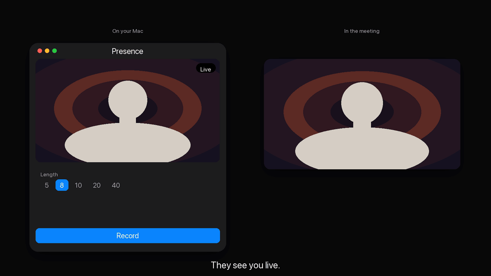
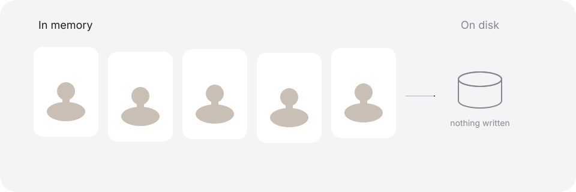
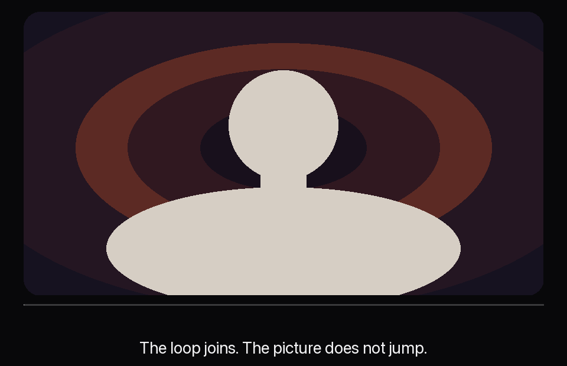

<div align="center">

<picture>
  <source media="(prefers-color-scheme: dark)" srcset="docs/assets/mark-dark.svg">
  <source media="(prefers-color-scheme: light)" srcset="docs/assets/mark-light.svg">
  
</picture>

# Presence

**You get up to pee. The meeting still sees you.**

Record a short take while the call still shows you live. Check it. Send that take, on a loop, and go. Come back, and the call sees you live again.

<picture>
  <source media="(prefers-color-scheme: dark)" srcset="docs/assets/steps-dark.svg">
  <source media="(prefers-color-scheme: light)" srcset="docs/assets/steps-light.svg">
  
</picture>



The countdown is on your Mac. The meeting never sees it.

**Zoom will not list a camera named Presence until Apple has signed the app.** The name to select is the one at the bottom of the window.

<p>Stay as long as you like.</p>

<p>
  <a href="#five-minutes"><b>Five minutes.</b></a> The reason you would want this.<br>
  <a href="#ten-minutes"><b>Ten minutes.</b></a> Why the picture holds up once you are actually gone.<br>
  <a href="#fifteen-minutes"><b>Fifteen minutes.</b></a> The keys, the camera, and a build you can run tonight.
</p>

</div>

## Five minutes

The meeting is fine. You are not.

You have been sitting in the same square of light for most of an hour, because the camera is a contract. Stand up, and the room watches you stand up. Turn the camera off, and the tile goes black, and a black tile is an announcement. Everyone does the math. Leave the last frame frozen, and you become a photograph of a person who has stopped blinking. Photographs do not nod. People notice that too.

So you stay. You cross your legs. You miss the thing you already stood up for in your head.

Sometimes that thing is a glass of water. Sometimes it is the bathroom. The meeting does not need the difference. It needs a person who is still in the chair.

Presence is that person.

You press record while everyone still sees you live. A countdown runs on your Mac, big enough to see without leaning in, and it does not run in the meeting. There is no number burned into the corner of the tile. There is no badge with your name, and no little red dot for them to wonder about. You do the take the way you would sit through the next minute anyway. Here. Looking at the lens. A person who has not gone anywhere.

Then you look at it.

The preview is the picture they will get, the right way around, not a mirror. If you hate it, you are still live. Nothing has left the room. The button says Cancel while the countdown is running, and cancel means cancel: the call never saw a take, and the previous one, if you had one, is still yours. If you like it, the button changes to Step away. You press it.

On your screen, you know you have left. On theirs, nothing changes. Same person. Same chair. Same light. You stand up for real.

<div align="center">

<picture>
  <source media="(prefers-color-scheme: dark)" srcset="docs/assets/leave-dark.svg">
  <source media="(prefers-color-scheme: light)" srcset="docs/assets/leave-light.svg">
  
</picture>

</div>

Come back when you are back. One press. The room has you live again, including the part where you sit down and become someone who was here the whole time. The take is still in the app. You can step away again on that same take, without recording another, for as long as Presence is open.

That is the product. A fresh take. A loop. A return.

Three things worth knowing before you close the tab.

You mute yourself before you go. This is video only. Presence will not invent a sentence, and it should not. A mouth that is simply a person in a chair is ordinary. A voice that repeats the same eight seconds is a broken speaker, and everyone in the room will hear the seam. Mute, then go.

The take is not a file. It lives in memory until you quit, or until a new recording replaces it. There is no clip on the desktop waiting for you to remember to delete it. When the app goes, the take goes with it.

And the camera in the meeting is not named Presence. Not yet. Apple has to sign the app before Zoom will list a camera by that name. Until a paid Developer team has signed it, you point the meeting at the camera named at the bottom of the Presence window. That name is OBS Virtual Camera or Elgato Virtual Camera. Set the meeting’s own background to None. Leave it on, and the background is painted twice. You will look like a person standing inside a copy of the room you are already in.

You can stop here. You know what it does, and you know the limit that matters.

The next five minutes are about why the loop does not look like a trick.

## Ten minutes

The take is from this call. This shirt. This lamp. The way you are sitting in this hour.

That is on purpose. A clip from Tuesday is a different person, and people can feel it even when they cannot say why the tile feels off. The last few seconds before you reached for the button would be worse. That is the video of you deciding to leave. Presence waits. You start the take when you are already the person you want the room to keep.

It is not a ring buffer, quietly saving whatever you just did. You choose the start. You choose the length. You look at the result before anyone else is asked to live with it.

<div align="center">

<picture>
  <source media="(prefers-color-scheme: dark)" srcset="docs/assets/memory-dark.svg">
  <source media="(prefers-color-scheme: light)" srcset="docs/assets/memory-light.svg">
  
</picture>

</div>

While the call goes on, the frames sit in memory. They are not in your camera roll. They are not a movie file with your name on it. Quit Presence and they are gone. Finish a new recording and the new one takes their place. Cancel halfway through that new one and the old take is still there, and you are live. There is no library of you in this app, and there is not going to be one. The useful thing is a person who is still in this meeting. An archive is a different product.

A loop has to join, because a loop that jumps is how someone catches you.

Near the end of the take, Presence looks for the later moment that most resembles the first frame, and it ends there. The last frame is the first frame. For a blink, those two mix, and only the last one does, so you do not get a second, fainter you hovering over the first. What the room sees is one picture that arrives back at its own beginning.

<div align="center">



</div>

The picture can wear the background you already use on calls. Presence reads the virtual backgrounds Zoom has saved on that Mac, and you pick the one that matches this meeting. The app does not ship a background, and it does not know which one is yours until you say so. Someone else who builds Presence picks from the folder on their machine. Yours stays yours.

Then the frame is pulled in the way a webcam usually is. There is a slider. Wider on one end, Closer on the other. The point of it is ordinary and easy to miss until it goes wrong. When the loop starts, your face should be where it was, up in the tile. A loop that suddenly shows you from the chest down is a confession that some other camera took over. The slider is how you stop that confession.

How long. Five seconds, eight, ten, twenty, or forty. The default is eight.

Eight is long enough to be a person settling, and short enough to repeat. Forty is there for the day you want a longer beat: a nod, a glance off, a glance back. The meeting will see that beat again. That is what a loop is. The work is to make the seam boring. A boring seam is a person who is still in the room.

Pick a take that can survive being seen twice. A wave, a point, anything you do once on purpose, becomes a joke the second time and a confession the third. Eight quiet seconds of you in the chair can repeat. A performance cannot. If you want a move in the forty-second take, make it the kind of move a person makes without noticing. A glance off. A glance back. Then the chair again.

And one limit, while you are still comfortable. If someone asks you a question, the take will not answer it. The picture does not know it was asked. Presence is for the stretch where you are scenery. The status update. The screen share. The part where someone else is talking and your job is to look like a person who is listening. It is a bad way to survive being called on. If you hear your name, you come back. That is what the second key is for.

You will not see the words Live, Take, or Loop in the meeting. You will not see the countdown. You will not see the button that says I’m back. All of that stays on your Mac, so you know which room you are in. They only get the picture.

You can stop here if you only wanted to trust it.

The last five minutes are the machine itself. The keys, the camera you already own, and the commands that build the app tonight.

## Fifteen minutes

The window is small on purpose. A preview. A length. A background. Two sliders. One button that changes its mind as you go: Record, then Cancel, then Step away, then I’m back. If the take is ready and you want another, Record again is sitting there, quiet, under the main button.

Glass goes from Off to Clear. Off is a solid window. Clear gets out of the way, and the type stays readable while it does. Leave the slider where you like the window. It will be there next time.

You can close the window. Presence keeps running. The Dock icon stays, and so does the menu bar item. You should not have to go find an app while you are already standing up.

<div align="center">

<picture>
  <source media="(prefers-color-scheme: dark)" srcset="docs/assets/keys-dark.svg">
  <source media="(prefers-color-scheme: light)" srcset="docs/assets/keys-light.svg">
  
</picture>

</div>

The defaults are Control-Option-R and Control-Option-L.

Control-Option-R starts a take. Press it again while the countdown is running and the take cancels. You are still live.

Control-Option-L sends the take to the meeting. Press it again and you are back.

Click either row and press the chord you actually want. It needs Control, Option, or Command. Shift can come along for the ride. Escape backs out if you were only looking. The labels use the same marks the Mac uses, in the same type as the rest of the window, so they do not look like a password.

### The camera you already have

Any real webcam can be the one Presence holds. The camera built into a MacBook. A USB camera. A phone on the desk. A Facecam. You do not need a particular brand. The menu lists real cameras, and it does not list virtual ones, so the picture cannot be fed back into itself and turn into a hall of mirrors.

Presence holds that camera and passes it through, live, until you arm the loop. The meeting is pointed at a different camera, and you point it there once. The name is written at the bottom of the window. Read that name. Select that name in Zoom, Meet, or Teams. It will not say Presence. When a paid Apple Developer signature can install the camera extension, other apps would see a camera by that name. This build does not pretend that day has arrived.

A Mac that has never had a virtual camera needs [OBS](https://obsproject.com). It is free. Open it, click Start Virtual Camera, and allow the extension under System Settings, General, Login Items & Extensions, Camera Extensions. Then click Stop Virtual Camera. Presence is the one that should be writing frames. OBS does not have to stay open. It cannot be the one writing at the same time, or there is nowhere for the picture to go.

If the webcam is busy, the window says so. In the meeting, choose the virtual camera, then pick the webcam in Presence again.

One more time, because this is the mistake that makes the picture look cursed. Turn the meeting’s own background off. Presence can already be painting the background you picked from Zoom’s folder. If Zoom paints it again on top, you get the room twice.

### Set it up

You need a Mac on macOS 26 or later, and Xcode 26 or later. This is not an App Store app. A download does not need to be notarized for you to build it yourself. You are building it because you want it, on your machine, tonight.

```bash
git clone https://github.com/HeroForgeAI/presence.git
cd presence
xcodegen generate
DEVELOPER_DIR=/Applications/Xcode.app/Contents/Developer \
  xcodebuild -scheme Presence -configuration Debug -destination 'platform=macOS' build
```

The built app is under `build/`. Copy it to `~/Applications` if you want it beside your other apps. Tests:

```bash
DEVELOPER_DIR=/Applications/Xcode.app/Contents/Developer \
  xcodebuild -scheme Presence -destination 'platform=macOS' test
```

Then:

1. Allow the camera prompt. If no prompt appears, turn Presence on under System Settings, Privacy & Security, Camera. Building an unsigned copy again can require that switch once more. The menu lists every real webcam. A virtual camera is not in that menu.
2. In Zoom, Meet, or Teams, choose the camera named at the bottom of the Presence window. It is not your built-in camera. Set that app’s background to None.
3. If this Mac has no virtual camera yet, do the OBS steps above. Start the virtual camera, allow the extension, then stop it so Presence can write.

A browser download of a built app gets a quarantine flag, and macOS refuses to open a stranger. Open it once, then use System Settings, Privacy & Security, Open Anyway. Or, for this app only:

```bash
xattr -dr com.apple.quarantine /Applications/Presence.app
```

That lets the app launch. It does not put a camera named Presence in Zoom. Cloning the repo and building it skips quarantine, because Git did not download an app. Homebrew does not change the camera rule. Turning off SIP does not either, and neither does turning off Gatekeeper. Those are not steps. They are not in this README because they are not the fix.

### Where the code lives

`Presence/` is the app. `PresenceCamera/` is the Core Media camera extension. The app writes frames into the extension’s sink. The extension’s source is what other apps would see, once a paid Apple Developer signature can install it. `AppIcon.icon` is the icon, with a light picture and a dark picture.

The app is Swift. The camera and the interface are Apple frameworks. A port to something else is not the project.

### Come help

The door is open. The lock on `main` is locked.

Want something the app does not do yet? Ask for it. Open an issue and pick [A feature](https://github.com/HeroForgeAI/presence/issues/new?template=feature.md). Say the moment you would use it, and what the other person on the call should see. You do not have to build it. If you want to build it, wait until you hear yes. A yes welcomes a pull request. It is not a week on the calendar, and it does not unlock `main`. He may say no. When he does, it comes with a reason.

Ideas and fixes are welcome, from people who write Swift and from people who do not. A confusing sentence is a real contribution. So is a note that says which Mac, which webcam, and what the other person actually saw. Open an issue and pick the question form. No question is too basic.

A change comes in as a pull request from your own fork. Nobody pushes straight to `main`. Mak Allen reads it, and he is the one who merges. He may say no. When he does, it comes with a reason. Write access is an invitation, later, after someone has been good to the project for a while. Opening a pull request does not hand you the keys. The app is small. A small app can be wrecked by one casual Tuesday, and the lock is how that does not happen.

If you send a change, send one change. Put a line in the changelog under Unreleased. Run the tests when you can, and if you could not, say which Mac you are on and why. For anything bigger than a small fix, open a feature issue first. You would rather hear yes, not like that, or no before you spend the evening.

Do not attach a recording, a shot of a real meeting, or anyone’s face. Describe the bug in words. A take is a person. It does not belong on a pull request. If a picture is required, use a stand-in.

There is a longer version of the welcome in [CONTRIBUTING.md](CONTRIBUTING.md). [GOVERNANCE.md](GOVERNANCE.md) says who merges, and what happens to a pull request that goes quiet: a nudge after two weeks, closed after four, and you can reopen it. Security issues go through [SECURITY.md](SECURITY.md), in private, and never into a public issue.

The edges, if you are choosing where not to spend a weekend:

- Mac only. Meet and Teams count when they can select the same virtual camera. Windows and Linux do not.
- Swift stays.
- The take stays in memory for the session. It is not a ring buffer, and it is not a clip on disk.
- Nobody’s background is hardcoded. Each person picks from the backgrounds on their own Mac.
- No claim that Zoom lists a camera named Presence, until a build signed with a paid Apple Developer certificate actually does.

The work that helps is the picture the other person sees. A join that does not hitch. A crop that does not jump. A background that matches the meeting. A long call that does not spin the fan the whole time.

<div align="center">

You get up. The meeting still sees you.

<p>
  <a href="LICENSE"></a>
  <a href="https://x.com/mrmakallen"></a>
</p>

Mac only. MIT license.

Built and maintained by <b>Mak Allen</b> of the <a href="https://github.com/HeroForgeAI">HeroForge.AI</a> team. Find him on X: <a href="https://x.com/mrmakallen">@mrmakallen</a>.

</div>
